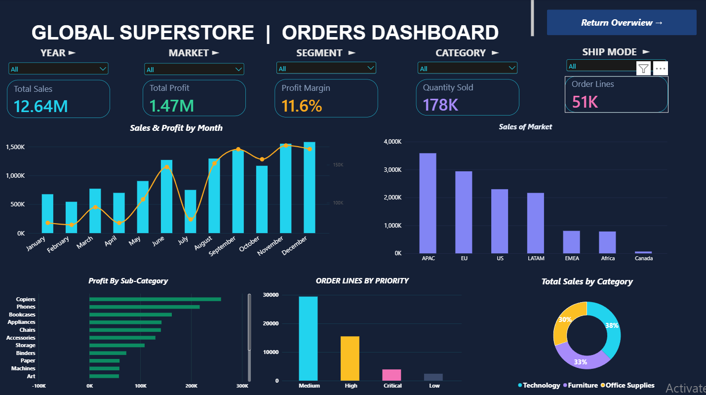
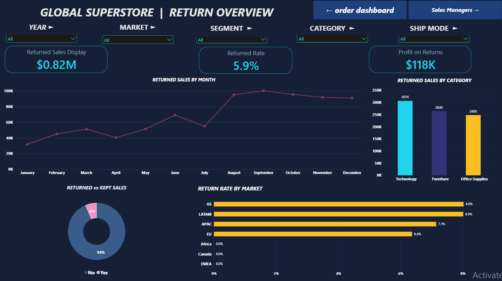
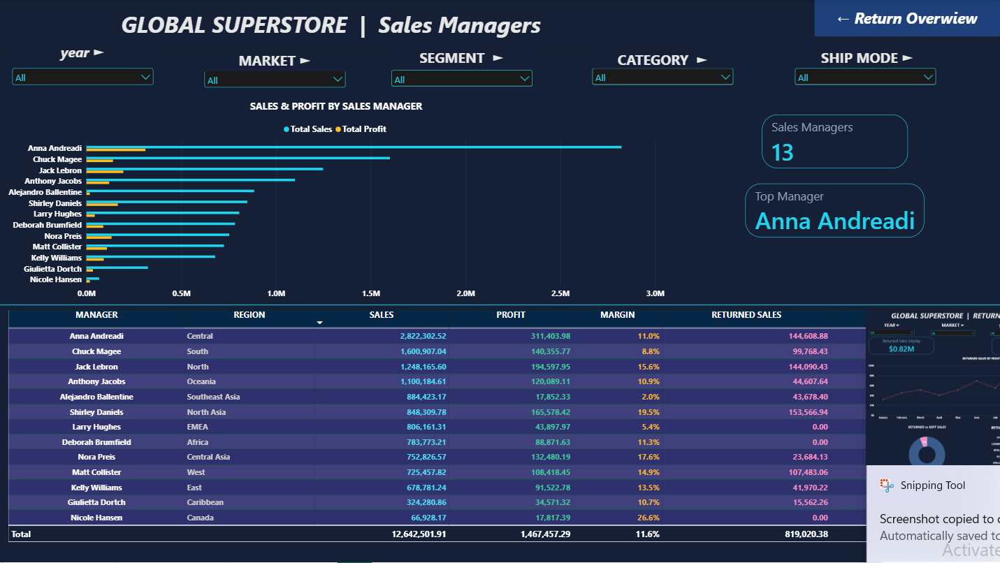

# Global Superstore Analysis

End-to-end data analysis project using SQL Server, Excel and Power BI on the Global Superstore dataset (Orders, Returns, People).

## Key Numbers
- Total Sales: $12.64M
- Total Profit: $1.47M
- Returned Sales: $0.82M
- Return Rate: 5.9%

## Tools
- SQL Server (SSMS): data cleaning, quality checks, KPIs and sales analysis
- Excel: interactive dashboard with slicers and navigation buttons
- Power BI: 3-page interactive report

## Project Files
- `Data_Qualty.sql`: data quality checks
- `KPIs.sql`: key performance indicators
- `Sales_Analysis.sql`: sales analysis queries
- `Advanced_SQL.sql`: advanced queries
- `Global_Superstore_Dashboard.xlsx`: Excel dashboard
- `Power BI Dashboard.pbix`: Power BI report

## Power BI Report

### Orders Dashboard

### Returns Overview

### Sales Managers

## Author
Mustafa